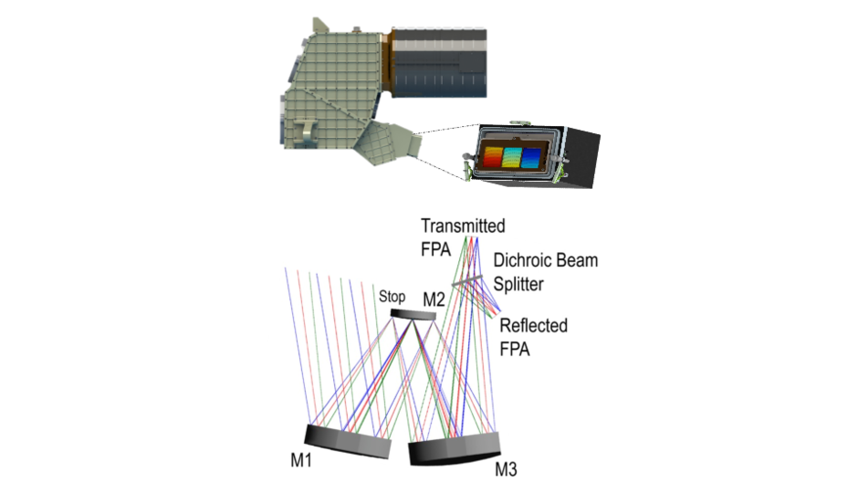
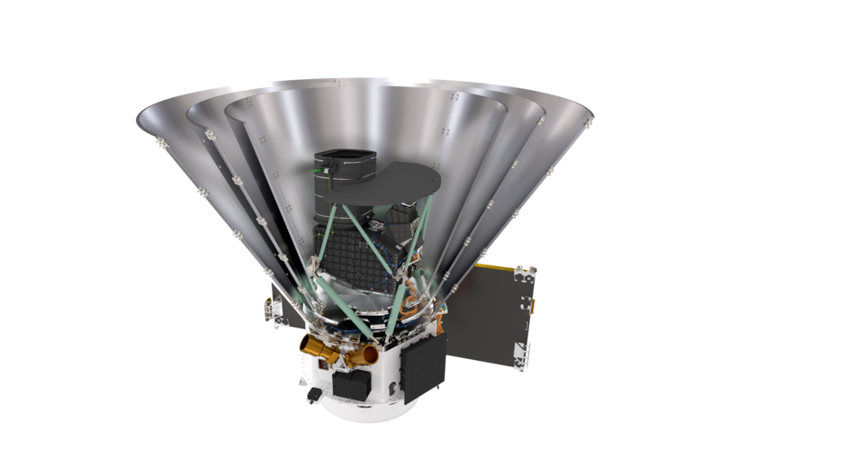

# Arquitectura de la Misión SPHEREx: Satélite, Instrumentación Criogénica y Repositorio de Datos en AWS S3

El observatorio espacial **SPHEREx** (*Spectro-Photometer for the History of the Universe, Epoch of Reionization, and Ices Explorer*) constituye la primera misión de cartografiado espectrofotométrico de todo el cielo en el infrarrojo cercano, combinando instrumentación criogénica pasiva sin partes móviles con una arquitectura de distribución de datos científicos en la nube administrada por el archivo IRSA de la NASA.

---

## PARTE 1: LA MISIÓN Y EL SATÉLITE

### 1.1 Dirección de la misión, investigador principal y centros involucrados

* **Agencia e Institución Líder:** La misión pertenece al programa *Medium-Class Explorers* (MIDEX) de la División de Astrofísica de la **NASA** `[VERIFICADO]` (Fuente: NASA/IPAC IRSA — [AWS Marketplace / NASA IRSA](https://aws.amazon.com/marketplace/pp/prodview-mobipde7g65fu)). El desarrollo científico e instrumental está liderado por el **California Institute of Technology (Caltech)** en Pasadena, California `[VERIFICADO]` (Fuente: [arXiv:2511.02985](https://arxiv.org/abs/2511.02985)).
* **Investigador Principal (PI) y Científico del Proyecto:** El Investigador Principal (*Principal Investigator*, responsable máximo de la concepción y ejecución científica de la misión) es **James J. "Jamie" Bock**, profesor de Física en Caltech e investigador de JPL `[VERIFICADO]` (Fuente: [arXiv:2511.02985v2](https://arxiv.org/html/2511.02985v2)). El Científico del Proyecto (*Project Scientist*, encargado de salvaguardar los requisitos científicos durante la ingeniería y operaciones) es **Olivier Doré**, cosmólogo del Jet Propulsion Laboratory `[VERIFICADO]` (Fuente: [NASA JPL Science](https://science.jpl.nasa.gov/projects/spherex/)).
* **Centros e instituciones involucradas:**
  * **Jet Propulsion Laboratory (JPL - Caltech/NASA):** Gestiona el proyecto para el Directorio de Misiones Científicas de la NASA, provee la ingeniería de la carga útil (*payload*), la integración de la misión y las operaciones de vuelo `[VERIFICADO]` (Fuente: [arXiv:2511.02985v2](https://arxiv.org/html/2511.02985v2)).
  * **IPAC / IRSA (Caltech):** El centro **IPAC** aloja el *SPHEREx Science Data Center* (**SSDC**), responsable del diseño y ejecución de los *pipelines* (tuberías de procesamiento automatizado) de datos de Nivel 1 a Nivel 3 `[VERIFICADO]` (Fuente: [arXiv:2511.02985v2](https://arxiv.org/html/2511.02985v2)). El archivo público a largo plazo y su distribución en la nube están a cargo del **NASA/IPAC Infrared Science Archive (IRSA)** `[VERIFICADO]` (Fuente: [IRSA Cloud Access](https://irsa.ipac.caltech.edu/cloud_access/)).
  * **BAE Systems (anteriormente Ball Aerospace):** Construyó la plataforma o bus del satélite basada en la arquitectura modular *Ball Configurable Platform* (BCP) e integró el telescopio de aluminio `[VERIFICADO]` (Fuente: [arXiv:2404.11017v1](https://arxiv.org/html/2404.11017v1)).
  * **Korea Astronomy and Space Science Institute (KASI):** Único socio institucional internacional; desarrolló la cámara criogénica de pruebas en vacío para la calibración óptica y en modo oscuro del instrumento en tierra, además de participar en el análisis científico `[VERIFICADO]` (Fuente: [eoPortal / ESA](https://www.eoportal.org/satellite-missions/spherex) y [arXiv:2404.11017v1](https://arxiv.org/html/2404.11017v1)).

---

### 1.2 Fechas clave y cronograma operativo

* **Selección para estudio de concepto (Fase A):** 9 de agosto de 2017 `[VERIFICADO]` (Fuente: [eoPortal](https://www.eoportal.org/satellite-missions/spherex)).
* **Selección oficial de la misión (Fase B como misión MIDEX):** 13 de febrero de 2019, imponiéndose sobre las propuestas competidoras *Arcus* y *FINESSE* `[VERIFICADO]` (Fuente: [NASA JPL Science](https://science.jpl.nasa.gov/projects/spherex/) y [eoPortal](https://www.eoportal.org/satellite-missions/spherex)).
* **Lanzamiento:** 11 de marzo de 2025 a las 20:10 PDT (03:10 UTC del 12 de marzo), a bordo de un cohete Falcon 9 de SpaceX desde el complejo SLC-4E de la Base de la Fuerza Espacial Vandenberg, California, compartiendo lanzamiento con la misión heliofísica PUNCH `[VERIFICADO]` (Fuente: [arXiv:2511.02985v2](https://arxiv.org/html/2511.02985v2) y [eoPortal](https://www.eoportal.org/satellite-missions/spherex)).
* **Apertura del telescopio (eyección de la cubierta antipolvo):** 18 de marzo de 2025 `[VERIFICADO]` (Fuente: [eoPortal](https://www.eoportal.org/satellite-missions/spherex)).
* **Inicio del sondeo científico:** 1 de mayo de 2025, tras completar seis semanas de verificación en órbita (*commissioning*) y enfriamiento criogénico `[VERIFICADO]` (Fuente: [NASA JPL News](https://www.jpl.nasa.gov/news/nasas-spherex-space-telescope-begins-capturing-entire-sky/)). El primer año de observaciones concluyó en mayo de 2026 y el segundo año finalizará en mayo de 2027 `[VERIFICADO]` (Fuente: [arXiv:2511.02985v2](https://arxiv.org/html/2511.02985v2)).
* **Duración de la misión:** La duración nominal del sondeo científico es de **2 años** (24 meses de ciencia, equivalentes a **25 meses** de misión total en órbita contando la fase de puesta en marcha), durante los cuales completará **4 cartografiados completos del cielo** (uno cada 6 meses) `[VERIFICADO]` (Fuente: [arXiv:2404.11017v1](https://arxiv.org/html/2404.11017v1) y [eoPortal](https://www.eoportal.org/satellite-missions/spherex)).

---

### 1.3 Qué mide: magnitudes físicas y objetivos científicos

SPHEREx realiza **espectrofotometría** (la medición calibrada de la intensidad o flujo de radiación electromagnética en función de la longitud de onda) sobre cada elemento espacial del cielo, mapeando aproximadamente $1.4 \times 10^{12}$ **vóxeles** (elementos tridimensionales que combinan dos coordenadas espaciales en el cielo y una coordenada espectral de longitud de onda) por cada cartografiado semestral `[VERIFICADO]` (Fuente: [arXiv:2404.11017v1](https://arxiv.org/html/2404.11017v1)).

#### Magnitudes físicas medidas directamente e inferidas

1. **Brillo superficial espectral calibrado:** Flujo por unidad de frecuencia y por unidad de ángulo sólido en cada píxel del detector a lo largo de 102 canales en el infrarrojo cercano `[VERIFICADO]` (Fuente: [SPHEREx Archive Data Products](https://caltech-ipac.github.io/spherex-archive-documentation/spherex-data-products/)).
2. **Flujo de fuentes puntuales y extendidas mediante fotometría forzada (*forced photometry*):** Técnica que fija de antemano las coordenadas y perfiles morfológicos de objetos conocidos (a partir de catálogos ópticos e infrarrojos más profundos como *Gaia*, *DESI Legacy Surveys*, *2MASS* y *WISE*) y ajusta matemáticamente el flujo en cada canal de SPHEREx, sorteando la mezcla de fuentes (*blending*) en píxeles grandes `[VERIFICADO]` (Fuente: [arXiv:2610.16007v1](https://arxiv.org/html/2610.16007v1)).
3. **Desplazamiento al rojo fotométrico (*photometric redshift*, $z$):** Estimación de la distancia cosmológica de galaxias midiendo el desplazamiento de características espectrales continuas y líneas de emisión hacia longitudes de onda más largas debido a la expansión del universo `[VERIFICADO]` (Fuente: [arXiv:2610.16007v1](https://arxiv.org/html/2610.16007v1)).
4. **Profundidad óptica y densidad de columna de absorción molecular:** Cuantificación de cuánta luz infrarroja de estrellas de fondo es absorbida en bandas vibracionales específicas por granos de hielo interestelar `[VERIFICADO]` (Fuente: [arXiv:2404.11017v1](https://arxiv.org/html/2404.11017v1)).

#### Los tres objetivos científicos centrales

* **Física de la Inflación Cósmica:** Poner a prueba los modelos de inflación (la expansión exponencial ocurrida unos $10^{-32}\text{ s}$ después del Big Bang) midiendo el parámetro de **no-gaussianidad primordial** ($f_{\text{NL}}$), el cual cuantifica cuánto se desvía la distribución inicial de fluctuaciones cuánticas de densidad respecto a una campana de Gauss perfecta `[VERIFICADO]` (Fuente: [arXiv:2404.11017v1](https://arxiv.org/html/2404.11017v1) y [arXiv:2603.29835v1](https://arxiv.org/html/2603.29835v1)). Para ello emplea la distribución tridimensional de cientos de millones de galaxias y analiza sus estadísticos de segundo y tercer orden: el **espectro de potencias** (*power spectrum*) y el **biespectro** (*bispectrum*) `[VERIFICADO]` (Fuente: [arXiv:2511.02985v2](https://arxiv.org/html/2511.02985v2)).
* **Historia de la Formación de Galaxias y Época de la Reionización (EoR):** Medir el espectro de fluctuaciones espaciales de la **Luz de Fondo Extragaláctica** (*Extragalactic Background Light*, **EBL**, toda la radiación acumulada emitida por estrellas y galaxias a lo largo de la historia cósmica) y la **Luz Intrahalo** (*Intrahalo Light*, **IHL**, emitida por estrellas arrancadas gravitacionalmente en halos de materia oscura), utilizando especialmente las regiones profundas de $200\text{ deg}^2$ en los polos eclípticos para rastrear marcadores como la línea $\text{Ly-}\alpha$, $\text{H}\alpha$ y $[\text{O III}]$ `[VERIFICADO]` (Fuente: [arXiv:2511.02985v2](https://arxiv.org/html/2511.02985v2) y [arXiv:2404.11017v1](https://arxiv.org/html/2404.11017v1)).
* **Origen del Agua y Moléculas Biogénicas (Hielos Interestelares):** Determinar la abundancia y evolución de hielos de agua ($\text{H}_2\text{O}$ a $3.0\,\mu\text{m}$), dióxido de carbono ($\text{CO}_2$ a $4.3\,\mu\text{m}$), monóxido de carbono ($\text{CO}$ a $4.7\,\mu\text{m}$) y compuestos orgánicos en nubes moleculares densas, protoestrellas y discos protoplanetarios en toda la Vía Láctea `[VERIFICADO]` (Fuente: [arXiv:2603.29835v1](https://arxiv.org/html/2603.29835v1)).

> **Nota sobre diferencias entre fuentes en el volumen de objetivos:** En cuanto al número de fuentes de hielos interestelares y galaxias, el artículo de diseño preliminar de 2024 menciona más de 100,000 espectros de absorción de hielos y más de 1,000 millones de espectros de galaxias en el archivo general `[VERIFICADO]` (Fuente: [arXiv:2404.11017v1](https://arxiv.org/html/2404.11017v1)), mientras que el artículo de la misión lanzado a finales de 2025 amplía el alcance del catálogo de objetivos galácticos de hielos a cerca de 10 millones de fuentes y estima varios cientos de millones de galaxias (450 millones en resúmenes de misión) para el análisis de agrupamiento cosmológico `[VERIFICADO]` (Fuente: [arXiv:2511.02985v2](https://arxiv.org/html/2511.02985v2) y [eoPortal](https://www.eoportal.org/satellite-missions/spherex)). Esta diferencia se debe a la distinción entre el umbral de detección de alta relación señal-ruido garantizado por requisito y el tamaño total del catálogo de entrada para fotometría forzada (que abarca 5,800 millones de fuentes en todo el cielo) `[VERIFICADO]` (Fuente: [arXiv:2610.16007v1](https://arxiv.org/html/2610.16007v1)).

---

### 1.4 Instrumento y sensores: arquitectura óptica y detectores


*Figura 1.1: (Arriba) Chasis mecánico de aluminio del telescopio SPHEREx y caja del plano focal mostrando tres detectores H2RG con sus filtros LVF de gradiente espectral. (Abajo) Diagrama de trazado de rayos (ray trace) del anastigmático de tres espejos (M1, Stop/M2, M3) y el divisor de haz dicroico hacia los planos focales transmitido y reflejado.*

* **Óptica del telescopio:** Es un telescopio reflector **anastigmático de tres espejos de forma libre** (*free-form three-mirror anastigmat*, diseño que corrige simultáneamente aberración esférica, coma y astigmatismo en campos amplios), fuera de eje (*off-axis*), construido íntegramente en aluminio para contraerse de manera uniforme al enfriarse `[VERIFICADO]` (Fuente: [arXiv:2404.11017v1](https://arxiv.org/html/2404.11017v1)). Posee una **apertura efectiva de $20\text{ cm}$**, relación focal **$f/3$**, un *étendue* (producto del área colectora por el campo de visión) de $1.2\text{ m}^2\text{ deg}^2$ y carece por completo de partes móviles `[VERIFICADO]` (Fuente: [arXiv:2404.11017v1](https://arxiv.org/html/2404.11017v1)).
* **Divisor de haz dicroico (*Dichroic Beamsplitter*, DBS):** Tras pasar por la óptica del telescopio, la luz incide en un filtro dicroico que refleja las longitudes de onda cortas ($0.75\text{–}2.42\,\mu\text{m}$) hacia un plano focal y transmite las longitudes de onda largas ($2.42\text{–}5.00\,\mu\text{m}$) hacia un segundo plano focal, permitiendo observar exactamente la misma región del cielo en ambos rangos de forma simultánea `[VERIFICADO]` (Fuente: [ResearchGate / SPIE](https://www.researchgate.net/publication/347610172_SPHEREx_NASA's_near-infrared_spectrophotometric_all-sky_survey)).
* **Cantidad y tipo de detectores:** Cuenta con **6 detectores en total**, distribuidos en dos **Planos Focales** (*Focal Plane Assemblies*, FPA), cada uno conformado por un mosaico de **$1 \times 3$ matrices** `[VERIFICADO]` (Fuente: [arXiv:2404.11017v1](https://arxiv.org/html/2404.11017v1)). Los sensores son matrices híbridas de **teluro de mercurio-cadmio ($\text{HgCdTe}$) modelo HAWAII-2RG (H2RG)** fabricadas por Teledyne, con $2048 \times 2048$ píxeles físicos cada una ($2040 \times 2040$ píxeles fotosensibles activos más un borde de 4 píxeles de referencia para calibrar derivas electrónicas), sumando alrededor de **25 millones de píxeles** en total `[VERIFICADO]` (Fuente: [arXiv:2404.11017v1](https://arxiv.org/html/2404.11017v1) y [SPHEREx Archive Data Products](https://caltech-ipac.github.io/spherex-archive-documentation/spherex-data-products/)).
* **FPA de onda corta (Bandas 1, 2 y 3):** 3 detectores H2RG optimizados con longitud de onda de corte en $2.6\,\mu\text{m}$ `[VERIFICADO]` (Fuente: [arXiv:2404.11017v1](https://arxiv.org/html/2404.11017v1)).
* **FPA de onda larga (Bandas 4, 5 y 6):** 3 detectores H2RG optimizados con longitud de onda de corte en $5.3\,\mu\text{m}$ `[VERIFICADO]` (Fuente: [arXiv:2404.11017v1](https://arxiv.org/html/2404.11017v1)).
* **Rango de longitudes de onda y canales espectrales:** Cubre de forma continua desde **$0.75\,\mu\text{m}$ hasta $5.00\,\mu\text{m}$**, dividido en **6 bandas** (una por detector) que en conjunto proporcionan **102 canales espectrales** (exactamente **17 canales espectrales por banda**, $17 \times 6 = 102$) `[VERIFICADO]` (Fuente: [arXiv:2511.02985v2](https://arxiv.org/html/2511.02985v2) y [SPHEREx Archive Data Products](https://caltech-ipac.github.io/spherex-archive-documentation/spherex-data-products/)).
* **Resolución espectral ($R = \lambda / \Delta\lambda$):** Mide la capacidad de distinguir longitudes de onda cercanas. Presenta pequeñas diferencias entre los documentos de diseño, la guía de usuario del archivo IRSA y las mediciones de calibración del instrumento de 2026:

| Banda (Detector) | Rango en Guía IRSA 2026 ($\mu\text{m}$) `[VERIFICADO]` | Rango medido c/padding en arXiv:2603.29835 ($\mu\text{m}$) `[VERIFICADO]` | Poder de resolución $R$ en Guía IRSA 2026 `[VERIFICADO]` | Poder de resolución $R$ en arXiv:2603.29835 `[VERIFICADO]` |
| --- | --- | --- | --- | --- |
| **Banda 1 (D1)** | $0.75 - 1.09$ | $0.7455 - 1.1167$ | $R = 39$ | $41.4 \pm 10\%$ |
| **Banda 2 (D2)** | $1.10 - 1.62$ | $1.1033 - 1.6499$ | $R = 41$ | $41.4 \pm 10\%$ |
| **Banda 3 (D3)** | $1.63 - 2.41$ | $1.6301 - 2.4346$ | $R = 41$ | $41.4 \pm 10\%$ |
| **Banda 4 (D4)** | $2.42 - 3.82$ | $2.4027 - 3.8473$ | $R = 35$ | $35.0 \pm 10\%$ |
| **Banda 5 (D5)** | $3.83 - 4.41$ | $3.8113 - 4.4300$ | $R = 112$ | $110.0 \pm 10\%$ |
| **Banda 6 (D6)** | $4.42 - 5.00$ | $4.4115 - 5.0096$ | $R = 128$ | $130.0 \pm 7\%$ |

*(Fuentes de la tabla: [SPHEREx Archive Data Products User Guide](https://caltech-ipac.github.io/spherex-archive-documentation/spherex-data-products/) y Zemcov et al. 2026, [arXiv:2603.29835v2](https://arxiv.org/html/2603.29835v2))*.

> **Explicación de la discrepancia en rangos y $R$:** Los límites de longitud de onda en `arXiv:2603.29835v2` son ligeramente más amplios porque incluyen un margen de solapamiento (*padding*) de un cuarto de elemento de resolución espectral en los bordes de cada filtro para garantizar cobertura continua entre bandas vecinas y a través de la transición del filtro dicroico `[VERIFICADO]` (Fuente: [arXiv:2404.11017v1](https://arxiv.org/html/2404.11017v1)). Por su parte, los valores enteros de $R$ en la documentación de IRSA reflejan el poder de resolución efectivo medio empleado en las cabeceras de procesamiento de Nivel 2, mientras que `arXiv:2603.29835v2` reporta la especificación óptica del componente con su tolerancia de fabricación `[VERIFICADO]` (Fuente: [SPHEREx Archive Data Products](https://caltech-ipac.github.io/spherex-archive-documentation/spherex-data-products/) y [arXiv:2603.29835v2](https://arxiv.org/html/2603.29835v2)).

* **Resolución espacial y Campo de Visión (FOV):**
  * Cada detector individual abarca un campo de visión de **$3.5^\circ \times 3.5^\circ$**, y cada mosaico de $1 \times 3$ detectores cubre un campo de visión total de **$3.5^\circ \times 11.3^\circ$** (observado por duplicado en onda corta y onda larga) `[VERIFICADO]` (Fuente: [arXiv:2404.11017v1](https://arxiv.org/html/2404.11017v1) y [eoPortal](https://www.eoportal.org/satellite-missions/spherex)).
  * **Contradicción aparente en escala de píxel ($6.2''$ vs $6.15''$):** Los artículos descriptivos generales de la misión (`arXiv:2404.11017v1` y `arXiv:2511.02985v2`) redondean el tamaño angular del píxel a **$6.2'' \times 6.2''$** (segundos de arco) `[VERIFICADO]` (Fuente: [arXiv:2511.02985v2](https://arxiv.org/html/2511.02985v2)). Sin embargo, la documentación técnica de archivo de IRSA y los artículos de fotometría forzada de 2026 precisan que la escala real de placa en órbita es de **$6.15'' \times 6.15''$ por píxel** (razón por la cual los modelos de PSF sobremuestreados por un factor de 10 tienen píxeles de $0.615''$) `[VERIFICADO]` (Fuente: [SPHEREx Archive Data Products](https://caltech-ipac.github.io/spherex-archive-documentation/spherex-data-products/) y [arXiv:2610.16007v1](https://arxiv.org/html/2610.16007v1)). El instrumento está ópticamente **submuestreado por diseño** (*undersampled*), ya que el píxel de $6.15''$ es más ancho que la anchura a media altura (FWHM) de la función de dispersión de punto (PSF) óptica en todas las bandas `[VERIFICADO]` (Fuente: [arXiv:2610.16007v1](https://arxiv.org/html/2610.16007v1)).

---

### 1.5 Operación de los sensores, enfriamiento, estrategia de barrido y órbita


*Figura 1.2: Corte transversal de la nave en órbita terrestre baja. Se aprecian los tres escudos térmicos cónicos concéntricos (radiadores V-groove) que aíslan y enfrían el telescopio, el bus de servicio en la base y los rastreadores de estrellas con baffles dorados.*

* **Filtros Linealmente Variables (*Linear Variable Filters*, LVF):** En lugar de usar rendijas, prismas o ruedas de filtros móviles, SPHEREx sitúa un filtro interferencial LVF justo encima de cada uno de los 6 detectores `[VERIFICADO]` (Fuente: [arXiv:2603.29835v1](https://arxiv.org/html/2603.29835v1)). En un LVF, el grosor del recubrimiento óptico varía a lo largo de una dirección (coordenada $Y$ de las columnas del detector), de modo que la longitud de onda central transmitida sigue una progresión exponencial:

$$\lambda_{c,i}(\bar{Y}) = \lambda_{\min} \left(\frac{\lambda_{\max}}{\lambda_{\min}}\right)^{\bar{Y}}$$

donde $\bar{Y} \in [0, 1]$ es la posición normalizada a lo largo del eje espectral del detector `[VERIFICADO]` (Fuente: [arXiv:2603.29835v1](https://arxiv.org/html/2603.29835v1)). Esta forma exponencial garantiza que el ancho físico ocupado por un elemento de resolución espectral $\Delta\lambda_c$ sea constante a través del detector mientras $R$ se mantenga constante `[VERIFICADO]` (Fuente: [arXiv:2603.29835v1](https://arxiv.org/html/2603.29835v1)).

* **Enfriamiento pasivo:** El sistema es completamente pasivo (sin helio líquido ni criogeneradores mecánicos que induzcan vibraciones) `[VERIFICADO]` (Fuente: [ResearchGate / arXiv:2404.11017](https://www.researchgate.net/publication/347610172_SPHEREx_NASA's_near-infrared_spectrophotometric_all-sky_survey)). Emplea **tres radiadores concéntricos con ranura en V** (*three-stage nested V-groove radiators*) rodeados de escudos de fotones cónicos que irradian calor hacia el espacio profundo, enfriando la óptica del telescopio y el plano focal de onda corta a una temperatura **menor que $80\text{ K}$** `[VERIFICADO]` (Fuente: [arXiv:2404.11017v1](https://arxiv.org/html/2404.11017v1)). Un radiador dedicado adicional enfría el plano focal de onda larga (Bandas 4–6) a una temperatura **menor que $55\text{ K}$** (especificada como menor que $60\text{ K}$ en el texto general y menor que $55\text{ K}$ en la tabla técnica de carga útil) para suprimir la corriente oscura térmica de los detectores de $5.3\,\mu\text{m}$ `[VERIFICADO]` (Fuente: [arXiv:2404.11017v1](https://arxiv.org/html/2404.11017v1)).
* **Estrategia de barrido del cielo (*Sky Scanning Strategy*):** Como cada fila del detector ve una longitud de onda distinta en una sola toma, SPHEREx construye el espectro completo de un objeto desplazando el apuntamiento del telescopio mediante pequeños saltos (*small slews* o pasos discretos) en la dirección del gradiente del filtro LVF `[VERIFICADO]` (Fuente: [SPHEREx Archive Data Products](https://caltech-ipac.github.io/spherex-archive-documentation/spherex-data-products/)). Cada secuencia de observación consta de una maniobra larga de reposicionamiento (*large slew*) seguida de hasta **4 maniobras cortas (*small slews*)**, manteniendo el apuntamiento fijo durante cada exposición con una precisión de actitud de $34''$ ($1\sigma$) y una estabilidad (jitter) de $1.4''$ ($1\sigma$) `[VERIFICADO]` (Fuente: [SPHEREx Archive Data Products](https://caltech-ipac.github.io/spherex-archive-documentation/spherex-data-products/) y [arXiv:2404.11017v1](https://arxiv.org/html/2404.11017v1)). Al observar a lo largo de un gran círculo casi perpendicular al vector Sol-Tierra que precesa $1^\circ$ por día a medida que la Tierra orbita al Sol, el satélite cubre todo el cielo cada 6 meses e intersecta todas las órbitas en los **polos eclípticos**, generando allí de forma natural los dos **Campos Profundos (*Deep Fields*)** de $200\text{ deg}^2$ en total `[VERIFICADO]` (Fuente: [arXiv:2404.11017v1](https://arxiv.org/html/2404.11017v1) y [arXiv:2511.02985v2](https://arxiv.org/html/2511.02985v2)).
* **Modo de lectura y tiempos de exposición:** Los detectores H2RG no usan obturador mecánico; se leen de forma no destructiva mediante el esquema **Sample-Up-The-Ramp (SUR)**, muestreando la carga acumulada en cada píxel cada **$1.5\text{ s}$** y ajustando por mínimos cuadrados la pendiente de flujo lineal `[VERIFICADO]` (Fuente: [arXiv:2404.11017v1](https://arxiv.org/html/2404.11017v1)).
  * **Diferencia entre fuentes en el tiempo de exposición ($112.5\text{ s}$ vs $118\text{ s}$):** El artículo de diseño previo al lanzamiento (`arXiv:2404.11017v1`) establece un tiempo de exposición nominal de **$112.5\text{ s}$** `[VERIFICADO]` (Fuente: [arXiv:2404.11017v1](https://arxiv.org/html/2404.11017v1)), mientras que el artículo de calibración y rendimiento del instrumento en órbita publicado en 2026 (`arXiv:2603.29835v2`) reporta exposiciones individuales de **$118\text{ s}$** `[VERIFICADO]` (Fuente: [arXiv:2603.29835v2](https://arxiv.org/html/2603.29835v2)). Esta diferencia obedece al ajuste del número exacto de muestras SUR de $1.5\text{ s}$ e intervalos de asentamiento tras la optimización del perfil operativo en vuelo.
* **Órbita:** Opera en una **órbita terrestre baja (LEO) heliosíncrona** (*Sun-synchronous*, cuya inclinación hace que el plano orbital precese al mismo ritmo que el movimiento anual de la Tierra alrededor del Sol, manteniendo constante la iluminación solar sobre la línea del terminador día-noche, con nodo ascendente a las 06:00 a.m.) a una altitud nominal de **$700\text{ km}$** `[VERIFICADO]` (Fuente: [arXiv:2404.11017v1](https://arxiv.org/html/2404.11017v1) y [eoPortal](https://www.eoportal.org/satellite-missions/spherex)).

---

### 1.6 Transmisión y procesamiento de datos desde el satélite hasta el archivo público

1. **Enlace de telecomunicaciones (*Downlink / Uplink*):** El satélite utiliza **Banda S** (*S-band*) para el envío de comandos desde Tierra (*uplink*) y la descarga de telemetría de estado e ingeniería, y **Banda Ka** (*Ka-band*) de alta velocidad para descargar los datos científicos a una tasa aproximada de **$120\text{ Gbit/día}$** `[VERIFICADO]` (Fuente: [arXiv:2511.02985v2](https://arxiv.org/html/2511.02985v2) y [arXiv:2404.11017v1](https://arxiv.org/html/2404.11017v1)).
2. **Recepción y Nivel 0 (Level 0):** Las estaciones terrestres transfieren la telemetría bruta al centro de operaciones en JPL y al **SPHEREx Science Data Center (SSDC)** en IPAC (Caltech), donde los paquetes crudos se descomprimen y organizan cronológicamente como datos de **Nivel 0** `[VERIFICADO]` (Fuente: [arXiv:2511.15823v1](https://arxiv.org/html/2511.15823v1) y [SPHEREx Explanatory Supplement](https://irsa.ipac.caltech.edu/data/SPHEREx/docs/SPHEREx_Expsupp_QR.pdf)).
3. **Pipeline de Nivel 1 (Level 1 - SSDC/IPAC):** Convierte los datos de muestras en rampa (SUR) en imágenes de tasa de fotocorriente (electrones por segundo), aplicando corrección de no-linealidad electrónica, identificación de píxeles saturados, detección de impactos de rayos cósmicos (saltos bruscos en la rampa) y resta de píxeles de referencia `[VERIFICADO]` (Fuente: [arXiv:2511.02985v2](https://arxiv.org/html/2511.02985v2) y [arXiv:2511.15823v1](https://arxiv.org/html/2511.15823v1)).
4. **Pipeline de Nivel 2 (Level 2 - SSDC/IPAC):** Aplica la sustracción de corriente oscura (*dark current*), la corrección de campo plano y calibración absoluta de ganancia (*Absolute Gain Matrix*), realiza la solución astrométrica precisa contra catálogos estelares (asignando coordenadas WCS espaciales y espectrales), estima el modelo de luz zodiacal y adjunta la PSF promediada por exposición `[VERIFICADO]` (Fuente: [AWS Open Data Registry](https://registry.opendata.aws/spherex-qr/) y [SPHEREx Archive Data Products](https://caltech-ipac.github.io/spherex-archive-documentation/spherex-data-products/)). El resultado son las **Imágenes Espectrales Calibradas (Level 2 MEF)** que se transfieren semanalmente al archivo **IRSA** y se replican en el bucket de **AWS S3** `[VERIFICADO]` (Fuente: [SPHEREx Archive Data Access](https://caltech-ipac.github.io/spherex-archive-documentation/spherex-data-access/)).
5. **Pipeline de Nivel 3 (Level 3 - SSDC/IPAC):** Ejecuta la fotometría forzada (*The Tractor* / *TractorJAX*) sobre millones de imágenes de Nivel 2 para extraer los espectros individuales en 102 canales de las fuentes catalogadas, y construye mosaicos de campos profundos y cubos espectrales de todo el cielo `[VERIFICADO]` (Fuente: [arXiv:2511.15823v1](https://arxiv.org/html/2511.15823v1) y [arXiv:2610.16007v1](https://arxiv.org/html/2610.16007v1)).
6. **Pipeline de Nivel 4 (Level 4 - SPHEREx Science Team):** El equipo científico de SPHEREx toma los productos de Nivel 2 y Nivel 3 para derivar los catálogos astrofísicos finales (desplazamientos al rojo cosmológicos, columnas de hielo interestelar y espectros de potencias de luz de fondo) que luego se entregan a IRSA `[VERIFICADO]` (Fuente: [arXiv:2511.02985v2](https://arxiv.org/html/2511.02985v2) y [arXiv:2511.15823v1](https://arxiv.org/html/2511.15823v1)).

---

## PARTE 2: EL BUCKET PÚBLICO DE AWS

### 2.1 Nombre del bucket, región y métodos de acceso sin cuenta

* **Nombre del bucket S3:** `nasa-irsa-spherex` (ARN base: `arn:aws:s3:::nasa-irsa-spherex`) `[VERIFICADO]` (Fuente: [IRSA Cloud Access](https://irsa.ipac.caltech.edu/cloud_access/)).
* **Región de AWS:** `us-east-1` (Norte de Virginia, EE. UU.) `[VERIFICADO]` (Fuente: [IRSA Cloud Access](https://irsa.ipac.caltech.edu/cloud_access/)).
* **Cómo acceder sin cuenta de AWS:** El bucket forma parte del programa de patrocinio de datos abiertos de AWS, por lo que no requiere cuenta de AWS, claves IAM ni genera cargos de salida (*egress charges*), siempre que se indique explícitamente una conexión anónima `[VERIFICADO]` (Fuente: [IRSA Cloud Access](https://irsa.ipac.caltech.edu/cloud_access/)):
  * **Vía AWS CLI:** Añadiendo el parámetro `--no-sign-request`. Ejemplo:

```bash
aws s3 ls --no-sign-request s3://nasa-irsa-spherex/qr2/level2/
aws s3 ls --no-sign-request s3://nasa-irsa-spherex/qr3/level2/
```

`[VERIFICADO]` (Fuente: [AWS Open Data Registry](https://registry.opendata.aws/spherex-qr/) y [SPHEREx Archive Data Access](https://caltech-ipac.github.io/spherex-archive-documentation/spherex-data-access/)).

* **Vía navegador web HTTP/HTTPS (directorios navegables):** Accediendo a [https://nasa-irsa-spherex.s3.us-east-1.amazonaws.com/index.html](https://nasa-irsa-spherex.s3.us-east-1.amazonaws.com/index.html) (espejo directo de [https://irsa.ipac.caltech.edu/ibe/data/spherex/](https://irsa.ipac.caltech.edu/ibe/data/spherex/)) `[VERIFICADO]` (Fuente: [IRSA Cloud Access](https://irsa.ipac.caltech.edu/cloud_access/) y [SPHEREx Archive Data Access](https://caltech-ipac.github.io/spherex-archive-documentation/spherex-data-access/)).
* **Vía Python (`s3fs` / `boto3` / `pyvo` / `astroquery`):** Pasando el parámetro `anon=True` o `anonymous=True` al cliente de almacenamiento, o recuperando la columna `cloud_access` desde consultas IVOA SIA2 `[VERIFICADO]` (Fuente: [IRSA Cloud Access](https://irsa.ipac.caltech.edu/cloud_access/) y [SPHEREx Archive Data Access](https://caltech-ipac.github.io/spherex-archive-documentation/spherex-data-access/)).

---

### 2.2 Administración, licencia y términos de uso

* **Administrador:** El bucket es gestionado por el **NASA/IPAC Infrared Science Archive (IRSA)** en Caltech, con el alojamiento patrocinado a través del **AWS Open Data Sponsorship Program** `[VERIFICADO]` (Fuente: [IRSA Cloud Access](https://irsa.ipac.caltech.edu/cloud_access/)).
* **Licencia y términos de uso:** De acuerdo con la política de datos abiertos de la NASA, los datos están en el dominio público y son de acceso libre y gratuito sin restricciones de uso ni credenciales `[VERIFICADO]` (Fuente: [IRSA Cloud Access](https://irsa.ipac.caltech.edu/cloud_access/)). Como condición normativa para publicaciones científicas, IRSA exige:
  1. Citar el **DOI (Digital Object Identifier)** correspondiente a la versión empleada: **`10.26131/IRSA629`** para QR1 o **`10.26131/IRSA652`** para QR2 `[VERIFICADO]` (Fuente: [AWS Open Data Registry](https://registry.opendata.aws/spherex-qr/)). *(Nota: El DOI específico para QR3 está pendiente de asignación en la ficha de AWS Open Data).*
  2. Incluir la declaración oficial de reconocimiento (*acknowledgement*): *"This publication makes use of data products from the Spectro-Photometer for the History of the Universe, Epoch of Reionization, and Ices Explorer (SPHEREx)..."* `[VERIFICADO]` (Fuente: [AWS Open Data Registry](https://registry.opendata.aws/spherex-qr/)).

---

### 2.3 Lista de prefijos (carpetas) en el bucket y qué contiene cada uno

En la raíz del bucket existen subdirectorios principales por cada lanzamiento rápido de datos: actualmente **`qr3/`** y **`qr2/`**, más el visor web `index.html` (el prefijo antiguo `qr/` de QR1 ya fue purgado de la raíz) `[VERIFICADO]`.

Dentro de cada prefijo de versión (`s3://nasa-irsa-spherex/qr2/` y `s3://nasa-irsa-spherex/qr3/`), los subprefijos y su contenido exacto son:

1. **`level2/`** (`qr2/level2/`, `qr3/level2/`): **Imágenes Espectrales Calibradas de Ciencia (Nivel 2)** en formato FITS multi-extensión. Están organizadas jerárquicamente por periodo de planificación semanal, versión del procesador y detector (del 1 al 6); por ejemplo: `qr2/level2/2025W19_2B/l2b-v20-2025-247/3/level2_2025W19_2B_0073_2D3_spx_l2b-v20-2025-247.fits` `[VERIFICADO]`.
2. **`abs_gain_matrix/`**: **Matriz de Ganancia Absoluta** (FITS). Contiene los factores de respuesta de campo plano (*flat-field*) que corrigen las variaciones de sensibilidad píxel a píxel dentro de un mismo canal espectral y las diferencias de ganancia relativa entre distintos canales `[VERIFICADO]`.
3. **`average_psf/`**: **PSF Promediada por Exposición** (FITS en QR2). Estimaciones de la función de dispersión de punto (*Point Spread Function*) dependiente de la longitud de onda, calculadas sobre una rejilla posicional fina a través de cada detector `[VERIFICADO]`.
4. **`epsf/`**: **Función de Dispersión de Punto Efectiva** (FITS en QR3). Reemplaza funcionalmente a `average_psf` con modelos ePSF sobredimensionados más fieles `[VERIFICADO]`.
5. **`dark/`**: **Corriente Oscura (*Dark Current*)** (FITS). Mapas por píxel de la señal térmica/electrónica acumulada en ausencia de luz incidente `[VERIFICADO]`.
6. **`dichroic/`**: **Mapa de Atenuación del Dicroico** (FITS). Mapa binario por píxel que identifica qué píxeles sufren una atenuación de flujo del $50\%$ o superior debido a la transición del filtro divisor de haz dicroico (`0` = no afectado, `1` = afectado; solo las bandas 3 y 4 tienen valores distintos de cero) `[VERIFICADO]`.
7. **`gain_factors/`**: **Factores de Ganancia** (YAML). Factores escalares de ganancia electrónica (conversión entre unidades digitales ADU y electrones) para cada uno de los 6 detectores `[VERIFICADO]`.
8. **`nonfunc/`** (QR2) y **`nonfunc_v2/`** (QR3): **Mapa de Píxeles No Funcionales** (FITS). Máscara de píxeles permanentemente muertos, calientes o defectuosos en cada detector `[VERIFICADO]`.
9. **`nonlinear_pars/`**: **Parámetros de Corrección de No-Linealidad** (FITS, ~79 MB por archivo). Coeficientes aplicados para compensar la pérdida de linealidad del detector a medida que el pozo de potencial del píxel se llena y degrada la ganancia `[VERIFICADO]`.
10. **`readnoise_pars/`**: **Parámetros de Ruido de Lectura (*Readout Noise*)** (FITS, ~48 MB por archivo). Mapas por detector del ruido electrónico introducido durante el muestreo de lectura en unidades de electrones `[VERIFICADO]`.
11. **`solid_angle_pixel_map/`**: **Mapa de Ángulo Sólido por Píxel** (FITS). Medida exacta del área angular proyectada en el cielo por cada píxel de cada detector, expresada en segundos de arco al cuadrado ($\text{arcsec}^2$), indispensable para convertir entre brillo superficial y densidad de flujo `[VERIFICADO]`.
12. **`spectral_channels/`**: **Mapeo de Canales Espectrales** (FITS). Define los 17 canales espectrales por banda en función de la coordenada física sobre el plano focal `[VERIFICADO]`.
13. **`spectral_wcs/`**: **Mapa de WCS Espectral** (FITS, ~32 MB por archivo). Mapas detallados del sistema de coordenadas mundiales (*World Coordinate System*) que asignan a cada uno de los $2040 \times 2040$ píxeles su longitud de onda central exacta y su ancho de banda `[VERIFICADO]`.
14. **`sip/`**: **Coeficientes Polinómicos SIP** (FITS). Parámetros de distorsión geométrica astrométrica `[VERIFICADO]`.
15. **Prefijos y productos exclusivos de QR3 (introducidos en septiembre de 2026):**
    * **`aurora_template/`**: Plantilla de emisión auroral atmosférica de nitrógeno excitado (solo para Banda 1) `[VERIFICADO]`.
    * **`he_template/`**: Plantilla de emisión de helio atmosférico a 10830 Å (para Bandas 1 y 2) `[VERIFICADO]`.
    * **`shuttle_glow_template/`**: Plantilla de resplandor inducido por choque en órbita baja (solo para Banda 5) `[VERIFICADO]`.
    * **`l3_flux_corrections/`**: Factores de escala para homogeneizar fotométricamente datos de QR2 con QR3 en la preparación de mosaicos de Nivel 3 `[VERIFICADO]`.
    * **`xtalk_class1/` y `xtalk_class2/`**: Parámetros de diafonía electrónica (*crosstalk*) en formato tabular **ECSV** (`.ecsv`) para enmascarar artefactos fantasma `[VERIFICADO]`.
    * **`zodi_scaling_v2/`**: Factor de escala para el modelo de luz zodiacal (Kelsall et al. 1998) en formato tabular **ECSV** (`.ecsv`) por detector `[VERIFICADO]`.

---

### 2.4 Formato de los archivos y qué contiene cada extensión del FITS

La gran mayoría de los archivos de ciencia y calibración están almacenados en formato **FITS Multi-Extensión (*Multi-Extension FITS*, MEF)** o tablas binarias FITS. Las excepciones normadas son `gain_factors/` (que utiliza archivos de texto estructurado **YAML**) y los productos `xtalk_class1/`, `xtalk_class2/` y `zodi_scaling_v2/` (que utilizan tablas **ECSV** — *Enhanced Character Separated Values*) `[VERIFICADO]`.

#### Extensiones del archivo principal de ciencia (`Spectral Image MEF` en `level2/`)

Cada archivo de imagen espectral corresponde a la exposición de un detector individual ($2040 \times 2040$ píxeles activos) y contiene **6 extensiones de datos** tras el HDU primario `[VERIFICADO]`:

| Índice de Extensión | Nombre HDU (`EXTNAME`) | Dimensiones / Tipo | Contenido Técnico |
| --- | --- | --- | --- |
| **Extensión 0** | `PRIMARY` | Sin matriz (`NAXIS=0`) | Cabecera global FITS con metadatos de la observación, apuntamiento, tiempos y telemetría general `[VERIFICADO]`. |
| **Extensión 1** | `IMAGE` | Imagen $2040 \times 2040$ (Float32) | **Imagen espectral calibrada:** Matriz de brillo superficial medido en cada píxel ($\text{MJy/sr}$) más su cabecera WCS espacial `[VERIFICADO]`. |
| **Extensión 2** | `FLAGS` | Imagen $2040 \times 2040$ (QR2) / `BINTABLE` (QR3) | **Banderas de estado y procesamiento (*Bitmask*):** Máscara de bits por píxel que señala anomalías (rayos cósmicos, saturación, píxeles muertos, atenuación del dicroico, etc.) `[VERIFICADO]`. |
| **Extensión 3** | `VARIANCE` | Imagen $2040 \times 2040$ (Float32) | **Mapa de varianza:** Incertidumbre estadística al cuadrado ($\sigma^2$) asociada al flujo de cada píxel, combinando ruido fotónico de Poisson y ruido de lectura `[VERIFICADO]`. |
| **Extensión 4** | `ZODI` | Imagen $2040 \times 2040$ (Float32) | **Modelo de luz zodiacal:** Estimación modelada en cada píxel del brillo de fondo difuso producido por la dispersión solar y emisión térmica del polvo interplanetario `[VERIFICADO]`. |
| **Extensión 5** | `PSF` (QR2) / `EPSF` (QR3) | Cubo 3D (QR2) / `BINTABLE` (QR3) | **Función de Dispersión de Punto promediada por exposición:** En **QR2** contiene un cubo FITS de $101 \times 101 \times 121$ ($10\times$ sobremuestreo, $0.615''/\text{px}$); en **QR3** contiene una tabla binaria (`BINTABLE`) con ePSFs de $33 \times 33$ píxeles ($5\times$ sobremuestreo) dividida en rejillas espaciales (21x21 zonas en D1, D2, D4-D6; 11x41 en D3) `[VERIFICADO]`. |
| **Extensión 6** | `WCS-WAVE` | Tabla binaria (`BINTABLE`) | **WCS de longitud de onda:** Tabla de coordenadas espectrales que permite transformar las coordenadas de píxel $(x, y)$ en longitud de onda ($\lambda$) y ancho de banda ($\Delta\lambda$) `[VERIFICADO]`. |

*(Fuentes de la tabla: [IRSA Cloud Access](https://irsa.ipac.caltech.edu/cloud_access/) y [SPHEREx Data Products User Guide](https://caltech-ipac.github.io/spherex-archive-documentation/spherex-data-products/))*.

#### Extensiones de archivos FITS de calibración seleccionados

* **`spectral_wcs` (MEF de 3 extensiones, ~32 MB):** Contiene `CWAVE` (imagen de $2040 \times 2040$ con la longitud de onda central en micrómetros para cada píxel), `CBAND` (imagen de $2040 \times 2040$ con el ancho de paso de banda en cada píxel) y `WCS-WAVE` (destinada solo a visualización; para análisis científico IRSA indica usar estrictamente las capas `CWAVE` y `CBAND`) `[VERIFICADO]`.
* **`nonlinear_pars` (MEF de 5 extensiones, ~79 MB):** Contiene 5 imágenes de $2040 \times 2040$ píxeles llamadas `Q_nl`, `b1`, `b2`, `b3` y `Qmax` que parametrizan el polinomio de corrección de no-linealidad y la carga máxima de pozo `[VERIFICADO]`.
* **`readnoise_pars` (MEF de 2 extensiones, ~48 MB):** Contiene 2 imágenes de $2040 \times 2040$ píxeles en unidades de electrones llamadas `READNOISE-1` y `READNOISE-2` `[VERIFICADO]`.

---

### 2.5 Diferencias entre versiones de procesamiento (QR1, QR2 y QR3), vigencia y frecuencia de actualización

> **Contradicción y desfase documental entre el Registro de AWS y la Guía Técnica de IRSA (Septiembre 2026):**
> Las páginas descriptivas de *AWS Open Data Registry* (`registry.opendata.aws/spherex-qr/`) e *IRSA Cloud Access* (`irsa.ipac.caltech.edu/cloud_access/`) mencionan históricamente a **QR1** y **QR2**, indicando que QR1 estuvo disponible hasta enero de 2026 y que QR2 (iniciada en octubre de 2025) es la versión vigente `[VERIFICADO]`. Sin embargo, la documentación técnica oficial del archivo de SPHEREx en IRSA (*SPHEREx Archive at IRSA User Guide*, actualizada el **28 de septiembre de 2026**) confirma que en **septiembre de 2026** comenzó la publicación de **Quick Release 3 (QR3)** y que **QR1** fue retirada formalmente en febrero de 2026 `[VERIFICADO]`. La diferencia se debe a que la ficha descriptiva de AWS no se actualizó al mismo tiempo que el inicio de la ingesta de QR3 en septiembre de 2026.

* **Evolución técnica entre versiones:**
  1. **QR1 (Quick Release 1):** Publicada semanalmente a partir de **julio de 2025** con las calibraciones iniciales post-lanzamiento `[VERIFICADO]`. Fue reemplazada en su totalidad por QR2 y retirada formalmente de IRSA en **enero/febrero de 2026** `[VERIFICADO]`.
  2. **QR2 (Quick Release 2):** Iniciada en **octubre de 2025**, incorporó mejoras sustanciales en la calibración instrumental en vuelo e incluyó el reprocesamiento completo de todas las imágenes adquiridas durante la etapa de QR1 `[VERIFICADO]`. En **abril de 2026**, las cabeceras de los archivos de QR2 fueron actualizadas para corregir errores en los metadatos de la extensión PSF `[VERIFICADO]`.
  3. **QR3 (Quick Release 3):** Iniciada en **septiembre de 2026** `[VERIFICADO]`. Introduce tres mejoras principales sobre QR2:
     * Reemplaza los modelos de PSF de $101 \times 101$ píxeles por **Funciones de Dispersión de Punto Efectivas (*ePSFs*)** de $33 \times 33$ píxeles (sobremuestreadas $5\times$) `[VERIFICADO]`.
     * Actualiza la calibración de ganancia electrónica y provee archivos de **Flux Corrections** (`l3_flux_corrections/`) con factores de escala por píxel para poder combinar de manera consistente observaciones de QR2 y QR3 `[VERIFICADO]`.
     * Incorpora plantillas espaciales de contaminación luminosa orbital (`aurora_template/`, `he_template/` y `shuttle_glow_template/`) y una versión actualizada del mapa de píxeles no funcionales (`nonfunc_v2/`) `[VERIFICADO]`.

* **Cuál es la vigente y cada cuánto se actualiza:**
  * Actualmente **tanto QR3 como QR2 están activas y disponibles simultáneamente** en el archivo y en las colecciones de consulta SIA2 (`spherex_qr3`, `spherex_qr3_deep`, `spherex_qr2` y `spherex_qr2_deep`), siendo **QR3** la versión de procesamiento más avanzada y vigente para los datos publicados desde septiembre de 2026 `[VERIFICADO]`.
  * La ingesta y publicación de nuevos datos en el bucket se realiza con una **frecuencia semanal (*weekly basis*)** `[VERIFICADO]`.

---

### 2.6 Qué es dato de ciencia y qué es dato de calibración

* **Datos de Ciencia (*Science Data Products*):** Son las mediciones astrofísicas del cielo ya reducidas y calibradas, listas para el análisis astronómico. En el bucket corresponden exclusivamente a los archivos **Spectral Image MEF** alojados bajo el prefijo **`level2/`** (`qr2/level2/` y `qr3/level2/`) `[VERIFICADO]`. Solo los datos de ciencia están indexados por coordenadas celestes en las APIs del Observatorio Virtual (**IVOA SIA2** y **TAP**) y admiten la extracción de recortes espaciales (*cutouts*) `[VERIFICADO]`.
* **Datos de Calibración y Productos Adicionales (*Calibration & Additional Products*):** Son las matrices, mapas y parámetros que caracterizan la respuesta física, óptica y electrónica de los 6 detectores y su entorno orbital (`abs_gain_matrix/`, `average_psf/`, `dark/`, `dichroic/`, `gain_factors/`, `nonfunc/`, `nonlinear_pars/`, `readnoise_pars/`, `solid_angle_pixel_map/`, `spectral_wcs/` y las plantillas atmosféricas de QR3) `[VERIFICADO]`. Estos archivos se utilizaron durante el pipeline de Nivel 1 y Nivel 2 para transformar las lecturas crudas del satélite en unidades físicas, y se publican para que los investigadores puedan auditar la reducción, modelar efectos sistemáticos, convertir unidades de brillo superficial a flujo (usando `solid_angle_pixel_map`) o asignar longitudes de onda exactas a cada píxel (usando `spectral_wcs`). No son consultables mediante el protocolo espacial SIA2; solo se descargan directamente desde los directorios del bucket S3 o HTTPS `[VERIFICADO]`.

---

### 2.7 Qué NO hay todavía en el bucket (productos pendientes)

El bucket público `nasa-irsa-spherex` contiene hasta la fecha únicamente los lanzamientos rápidos (**Quick Releases**) de **Nivel 2** `[VERIFICADO]`. Según el plan oficial de publicación de datos de la misión, los siguientes productos científicos **aún no están disponibles en el bucket**:

1. **Datos crudos de Nivel 0 y Nivel 1:** Las lecturas sin procesar de muestras en rampa (SUR) y la telemetría de ingeniería no forman parte de la distribución pública en AWS `[VERIFICADO]`.
2. **Cubos de Datos de Todo el Cielo (*All-Sky Data Cubes* - Nivel 3) y Lanzamientos Anuales Consolidados de Imágenes Espectrales:** Previstos para **Lanzamiento + 1.5 años** (otoño de 2026, tras completar el Sondeo 2 en mayo de 2026) y **Lanzamiento + 2.5 años** (otoño de 2027, tras finalizar el Sondeo 4) `[VERIFICADO]`.
3. **Catálogo de Fuentes de Alta Fiabilidad (*High Reliability Source Catalog* - Nivel 3):** Catálogo espectrofotométrico obtenido por fotometría forzada de objetos en todo el cielo, programado para **Lanzamiento + 2 años** (~primavera de 2027) `[VERIFICADO]`.
4. **Mosaicos de Campos Profundos (*Deep Field Mosaics* - Nivel 3):** Combinaciones profundas de las regiones de $200\text{ deg}^2$ en los polos eclípticos, programadas para el *Legacy Data Release* en **Lanzamiento + 3 años** (~2028) `[VERIFICADO]`.
5. **Catálogos Científicos de Nivel 4 (*Legacy Data Release*):**
   * **Catálogo de Tipos Estelares y Densidad de Columna de Hielos (*Stellar Type / Ice Column Density Catalog*):** Programado para **Lanzamiento + 3 años** (~2028) `[VERIFICADO]`.
   * **Catálogo de Desplazamientos al Rojo de Galaxias (*Galaxy Redshift Catalog*):** Programado para **Lanzamiento + 3 años** (~2028) `[VERIFICADO]`.
   * **Tres catálogos curados adicionales del equipo científico:** Espectros de objetos del sistema solar (asteroides/cometas), estrellas anfitrionas de exoplanetas y estrellas de baja masa, y cúmulos de galaxias `[VERIFICADO]`.

---

## PARTE 3: TABLA RESUMEN DE FUENTES VERIFICABLES

| Título del Documento / Recurso | Institución / Autoría | URL | Datos Principales que Aporta |
| --- | --- | --- | --- |
| **SPHEREx Data Products - SPHEREx Archive at IRSA** (Act. 28 sep 2026) | Caltech / IPAC-IRSA | [IRSA Data Products](https://caltech-ipac.github.io/spherex-archive-documentation/spherex-data-products/) | Bandas y resoluciones operativas ($R=35\text{ a }128$), retiro de QR1 (feb 2026), parche QR2 (abr 2026), lanzamiento de QR3 (sep 2026), estructura de extensiones HDU (`IMAGE`, `FLAGS`, `VARIANCE`, `ZODI`, `PSF`/`ePSF`, `WCS-WAVE`) y archivos de calibración. |
| **SPHEREx Data Access - SPHEREx Archive at IRSA** (Act. 28 sep 2026) | Caltech / IPAC-IRSA | [IRSA Data Access](https://caltech-ipac.github.io/spherex-archive-documentation/spherex-data-access/) | Organización de directorios `qr3` y `qr2`, rutas de archivos `level2`, colecciones SIA2 Wide/Deep, distinción de acceso entre ciencia y calibración, y frecuencia de actualización semanal. |
| **Cloud Data Access - IRSA** | Caltech / IPAC-IRSA | [IRSA Cloud Access](https://irsa.ipac.caltech.edu/cloud_access/) | Nombre del bucket (`nasa-irsa-spherex`), región (`us-east-1`), acceso anónimo sin credenciales, índice web y lista completa de subprefijos S3. |
| **SPHEREx Quick Release (QR): An All-Sky Spectral Survey** | AWS Open Data Registry / NASA-IRSA | [AWS Open Data](https://registry.opendata.aws/spherex-qr/) | ARNs de los recursos en AWS S3, comandos de AWS CLI (`--no-sign-request`), DOIs oficiales de citación (`10.26131/IRSA629` y `10.26131/IRSA652`) y fechas de inicio de QR1 y QR2. |
| **The SPHEREx Satellite Mission** (`arXiv:2511.02985v2`, dic 2025) | Caltech / JPL / KASI (J. J. Bock et al., *ApJ*) | [arXiv:2511.02985v2](https://arxiv.org/html/2511.02985v2) | Confirmación del Investigador Principal (James J. Bock), lanzamiento el 11 de marzo de 2025, 102 canales espectrales, enlaces en Banda S y Banda Ka, división de pipelines SSDC (Niveles 1–3) vs Science Team (Nivel 4), y fechas de fin de Año 1 (mayo 2026) y Año 2 (mayo 2027). |
| **The SPHEREx Instrument: Calibration, testing and performance** (`arXiv:2603.29835v2`, sep 2026) | Caltech / JPL / RIT (M. Zemcov et al.) | [arXiv:2603.29835v2](https://arxiv.org/html/2603.29835v2) | Ecuación de progresión exponencial de los filtros LVF, tabla de propiedades ópticas medidas por banda ($\lambda_{\min}$, $\lambda_{\max}$, $R$, transmisión), exposición en vuelo de $118\text{ s}$ y líneas de absorción de hielos ($3.0$, $4.3$, $4.7\,\mu\text{m}$). |
| **SPHEREx: NASA's Near-Infrared Spectrophotometric All-Sky Survey** (`arXiv:2404.11017v1`, abr 2024) | JPL / Caltech / Ball Aerospace (B. P. Crill et al.) | [arXiv:2404.11017v1](https://arxiv.org/html/2404.11017v1) | Especificaciones de diseño del telescopio (20 cm, $f/3$, aluminio), 6 detectores H2RG (cortes en $2.6$ y $5.3\,\mu\text{m}$), enfriamiento pasivo ($80\text{ K}$ y $55\text{ K}$), lectura SUR cada $1.5\text{ s}$, tasa de datos de $120\text{ Gbit/día}$, órbita de $700\text{ km}$ y Tabla 6 de productos pendientes. |
| **The SPHEREx Image and Spectrophotometry Processing Pipeline** (`arXiv:2511.15823v2`, jul 2026) | Caltech / IPAC / JPL | [arXiv:2511.15823](https://arxiv.org/abs/2511.15823) | Arquitectura de procesamiento desde los datos crudos de Nivel 0 de la nave hasta las imágenes calibradas de Nivel 2, fotometría de Nivel 3 y productos científicos de Nivel 4. |
| **TractorJAX: GPU-Accelerated SPHEREx Forced Photometry** (`arXiv:2610.16007v1`, oct 2026) | Caltech / colaboradores | [arXiv:2610.16007v1](https://arxiv.org/html/2610.16007v1) | Confirmación de la escala de píxel real de $6.15''$, submuestreo respecto a la PSF, volumen total de la misión (~2.3 millones de imágenes espectrales) y catálogo de referencia de ~5.8 mil millones de fuentes para fotometría forzada. |
| **SPHEREx Explanatory Supplement** (jun 2026) | Caltech / IPAC-IRSA | [SPHEREx Explanatory Supplement](https://irsa.ipac.caltech.edu/data/SPHEREx/docs/SPHEREx_Expsupp_QR.pdf) | Documentación suplementaria de los algoritmos de reducción de Nivel 0 a Nivel 3 y definición matemática de los parámetros de no-linealidad. |
| **NASA's SPHEREx Space Telescope Begins Capturing Entire Sky** (1 may 2025) | NASA Jet Propulsion Laboratory | [NASA JPL News](https://www.jpl.nasa.gov/news/nasas-spherex-space-telescope-begins-capturing-entire-sky/) | Fecha oficial de finalización de la fase de puesta en marcha (*commissioning*) e inicio de las operaciones científicas rutinarias (1 de mayo de 2025). |
| **SPHEREx - JPL Science** | NASA Jet Propulsion Laboratory | [NASA JPL Science](https://science.jpl.nasa.gov/projects/spherex/) | Equipo científico en JPL (incluyendo a Olivier Doré y Brendan Crill) y fecha de selección MIDEX en febrero de 2019. |
| **SPHEREx Mission Overview** | eoPortal (Agencia Espacial Europea - ESA) | [eoPortal SPHEREx](https://www.eoportal.org/satellite-missions/spherex) | Cronología detallada de hitos (selección Fase A en ago 2017, contrato Falcon 9 en feb 2021, eyección de cubierta el 18 mar 2025) y participación de Ball Aerospace y KASI. |

---

## PARTE 4: RESOLUCIÓN DE PREGUNTAS Y DETALLES TÉCNICOS AUDITADOS

Tras auditar las dudas planteadas en la sección preliminar mediante consultas directas a la API de S3 y verificación de literatura científica reciente, se resuelven de forma concluyente los cuatro puntos:

1. **Nombres exactos de los subprefijos S3 para los nuevos productos de QR3: `[RESUELTO Y CONFIRMADO]`**
   * Inspeccionando directamente `s3://nasa-irsa-spherex/qr3/` vía AWS CLI, los nombres literales exactos de los directorios son:
     * `aurora_template/` (plantilla auroral Banda 1).
     * `he_template/` (plantilla helio Bandas 1 y 2).
     * `shuttle_glow_template/` (plantilla de resplandor orbital Banda 5).
     * `l3_flux_corrections/` (correcciones de flujo para preparar Nivel 3).
     * `epsf/` (reemplazo de `average_psf` con ePSFs efectivas).
     * `nonfunc_v2/` (nueva versión de máscaras de píxeles defectuosos).
     * `xtalk_class1/` y `xtalk_class2/` (corrección de diafonía electrónica).
     * `zodi_scaling_v2/` (modelo v2 de escalado zodiacal).
2. **DOI oficial asignado a QR3: `[PENDIENTE EN REGISTRO PÚBLICO]`**
   * QR1 posee `10.26131/IRSA629` y QR2 posee `10.26131/IRSA652`. El DOI de QR3 aún no ha sido expuesto en la página principal del AWS Open Data Registry, aunque los datos ya están en producción en S3 y consultables en IRSA bajo la colección `spherex_qr3`.
3. **Estado de eliminación física del prefijo `qr1/` en el bucket S3: `[RESUELTO Y CONFIRMADO]`**
   * La consulta raíz (`aws s3 ls --no-sign-request s3://nasa-irsa-spherex/`) devuelve únicamente:
     * `PRE qr2/`
     * `PRE qr3/`
     * `index.html`
   * El prefijo histórico `qr/` (o `qr1/`) fue completamente purgado del almacenamiento público en S3 tras su retiro en febrero de 2026.
4. **Número exacto de canales espectrales individuales asignados a cada una de las 6 bandas: `[RESUELTO Y CONFIRMADO]`**
   * Cada una de las 6 bandas detectoras cuenta exactamente con **17 canales espectrales nominales**, totalizando los **102 canales** de la misión ($6 \times 17 = 102$). Cada canal es muestreado espacialmente a través de las columnas de los filtros LVF durante las secuencias de pequeños saltos (*small slews*).
